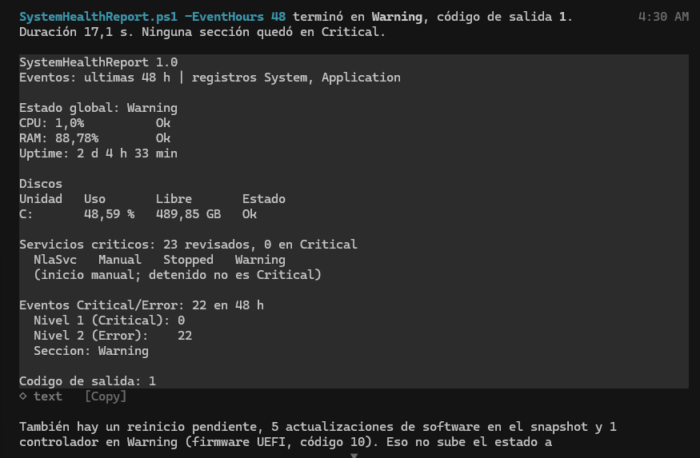
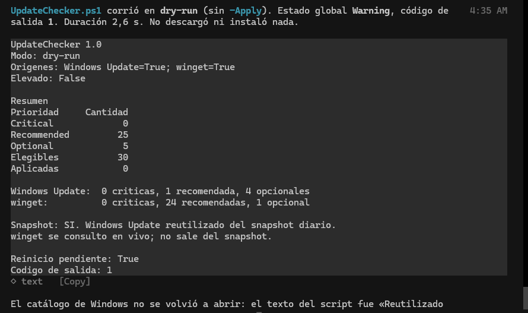
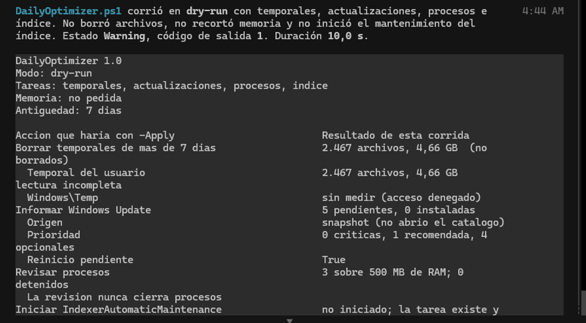
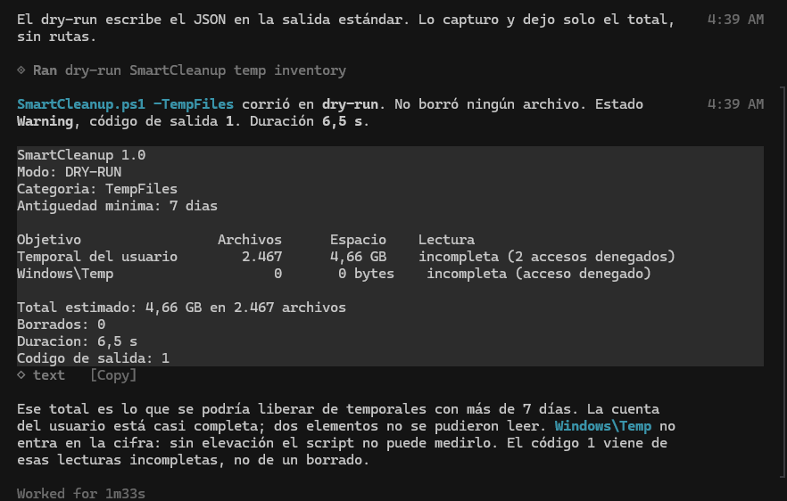
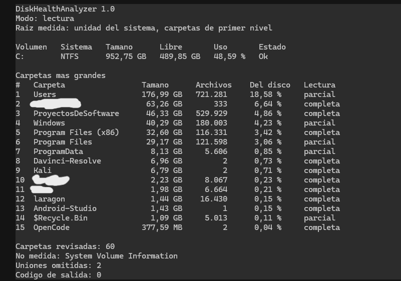
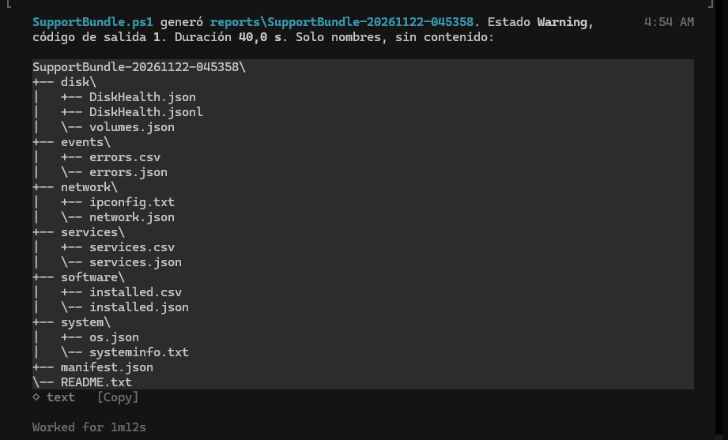
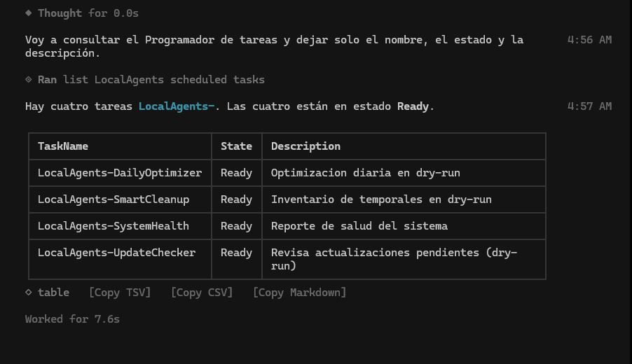

# LocalAgents


> Personal local automation project for Windows 11.  
> Demonstrates operational judgment in scripting, observability, severity handling (exit codes), dry-run, and support/SRE best practices.  
> This is not a commercial product. It is intended as evidence of technical work.

Local operations suite for Windows 11, written in Windows PowerShell 5.1. Covers the daily round of a Support Specialist or endpoint SRE: disk, temporary files, health, updates, processes, and an escalation package.

Each run produces a JSON report, a JSONL log with `runId`, and a stable exit code. Task Scheduler uses that code as an alert. The suite operates on the machine where it runs. It does not manage a fleet and does not depend on PowerShell 7.

Commands are launched from the repository root. In this document, `<repo>` refers to that root.

## Suite description

Replaces manual review of Event Viewer, disk usage, services, Windows Update, and temporary folders with six repeatable commands.

- Anything that can modify the machine stays in dry-run until `-Apply` is passed.
- A warning and an incident do not share the same exit code. `NlaSvc` stopped with Manual start, or a UEFI firmware, remain Warning.
- Evidence travels with the run: JSON snapshot, JSONL audit log, and exit code.
- The Windows Update catalog is opened once per cache window. The rest of the chain reads the snapshot.

Shared behavior lives in `scripts\Common.psm1`. The six scripts import it.

## Scripts

| Script | Function | Mutation |
|---|---|---|
| `scripts\DiskHealthAnalyzer.ps1` | Fixed volumes and top-level folders with `robocopy /L`. Warning from 80 % usage, Critical from 90 %. | Read-only. `-DryRun` skips the JSON file. |
| `scripts\SmartCleanup.ps1` | Inventory of temporary files, Windows and browser caches, NuGet, `Windows.old`, and Recycle Bin. Does not touch passwords, bookmarks, or history. | Dry-run unless `-Apply`. |
| `scripts\SystemHealthReport.ps1` | CPU, RAM, disks, services, events, uptime, Windows Update, and error drivers. Always writes JSON; HTML with `-Html`. | Read-only. |
| `scripts\DailyOptimizer.ps1` | Temporary files, update snapshot, memory, processes, and search index. Does not close processes or install updates. | Dry-run unless `-Apply`. |
| `scripts\SupportBundle.ps1` | Escalation folder: system, disk, events, services, network, and software. Does not collect Wi-Fi passwords or use `Win32_Product`. | Always writes the package. |
| `scripts\UpdateChecker.ps1` | Windows Update and winget, prioritized. Only script that opens the catalog. Never installs Critical updates or reboots. | Dry-run unless `-Apply`. |
| `scripts\Common.psm1` | Session, log, JSON, rotation, dry-run, exit code, and tree measurement. | Not executed alone. |

## Manual usage

Requirements: Windows PowerShell 5.1, `robocopy.exe` for disk analysis, and `winget.exe` if that source is queried. Reporting does not require administrator. Installing Windows updates does.

```powershell
Set-Location <repo>

powershell.exe -NoProfile -ExecutionPolicy Bypass -File .\scripts\SystemHealthReport.ps1 -EventHours 48
powershell.exe -NoProfile -ExecutionPolicy Bypass -File .\scripts\UpdateChecker.ps1
powershell.exe -NoProfile -ExecutionPolicy Bypass -File .\scripts\SmartCleanup.ps1 -TempFiles
powershell.exe -NoProfile -ExecutionPolicy Bypass -File .\scripts\DailyOptimizer.ps1 -TempFiles -PendingUpdates -ReviewProcesses -SearchIndex
powershell.exe -NoProfile -ExecutionPolicy Bypass -File .\scripts\DiskHealthAnalyzer.ps1
powershell.exe -NoProfile -ExecutionPolicy Bypass -File .\scripts\SupportBundle.ps1
```

`-Apply` deletes or installs. Cleanup and optimizer ask for `SI` confirmation unless `-Force` is used. Those two options are not part of the current scheduled tasks.

`SmartCleanup` in dry-run writes the JSON to standard output and does not create the report file. The JSONL log is still updated. Redirect the output if you want to keep the document.

## Exit codes

`Get-ReportExitCode` translates the state of a closed report. If the script fails before closing it, `Get-FatalExitCode` returns 3. A non-zero code causes Task Scheduler to mark the task as failed.

| Code | Meaning |
|---|---|
| 0 | Ok |
| 1 | Warning, or an unrecognized state |
| 2 | Critical. In disk, support, and optimizer, also a section Error |
| 3 | Failure before closing the report |

| Script | 0 | 1 | 2 |
|---|---|---|---|
| SystemHealthReport | Measured sections Ok | Warning, or an unreadable section, without Critical | At least one real Critical |
| UpdateChecker | Nothing pending and no warnings | Recommended, optional, reboot, or a failed source, without Critical | At least one Critical update |
| SmartCleanup | Complete inventory | Rejected targets or incomplete reads | Reserved: this routine does not mark Critical |
| DiskHealthAnalyzer, DailyOptimizer, SupportBundle | Ok state | Warning | Critical or Error |

In `SystemHealthReport` it is Critical, and therefore exit code 2:

- A Required service missing, disabled, or Automatic without Delayed Auto Start and stopped.
- Memory at 95 % or more, or a volume at 90 % or more. CPU at 90 % or more is Warning.
- At least one level-1 event. Level-2 events are Warning.
- A device with code 10, 12, 18, 24, 28, or 31, except firmware or an id starting with `UEFI\`.
- The `wuauserv` service does not exist.

Remains Warning: a Required service on Manual and stopped (`NlaSvc`), an Automatic with Delayed Auto Start that is stopped, a UEFI firmware, a pending reboot, and pending updates. An unreadable section is Error in its block and Warning in the global state. Code 2 requires a real Critical.

In `UpdateChecker` it is Critical an update that is mandatory, of MSRC Critical or Important severity, or of category Critical Updates. Excluded from Critical are definitions, drivers, BrowseOnly, feature packs, Preview, Security Updates of Moderate, Low, or no severity, and any winget package.

`Get-ReportExitCode` still maps the string `Error` to 2. Health and updates do not pass that string as global state: they fold it to Warning if there is no real Critical. Disk, support, and optimizer can exit 2 because of a section Error.

## Architecture and improvements

### Shared module

Log, JSON, rotation, and exit code were repeated in every script. They now live in `Common.psm1`:

| Function | Responsibility |
|---|---|
| `Initialize-CommonSession` | `runId`, log path, and dry-run mode of the session |
| `Write-Log` | JSONL with `timestamp`, `level`, `event`, `script`, `runId`, `pid`, and `dryRun` |
| `Write-JsonReport` | UTF-8 report with BOM. Warns above 32 MB |
| `Get-ReportExitCode` | 0 Ok, 1 Warning, 2 Critical or Error |
| `Invoke-LogRotation` | Rotates the active log at 5 MB and keeps 3 generations |
| `Measure-TreeFiles` | Single read-only pass, compiled once |
| `Read-WindowsUpdateSnapshot` / `Write-WindowsUpdateSnapshot` | Current catalog, 20-hour window |

Scripts no longer define those functions. The module does not see the caller's script variables: session state is stored inside the module.

### Folder measurement

Measurement used to walk each tree twice, or file by file in PowerShell. It moved to a single native read-only pass. It does not follow reparse points. The age filter excludes young files from the count; it does not avoid walking the directory.

| Dry-run | Before | After |
|---|---|---|
| SmartCleanup, all categories, 7 days | 287.5 s | 4.6 s |
| SmartCleanup, `-OlderThanDays 0` | the same 287.5 s walk | 5.9 s, with the full tree counted |
| DailyOptimizer, five tasks and its own Windows Update query | 332.5 s | 8.1 s, reading the snapshot |

Default `-OlderThanDays` changed from 0 or 1 to 7. The control with 0 shows that time drops because of the single pass: the same files are still counted. The value 7 only changes what would be included in an `-Apply`.

Deletion, if `-Apply` is ever used, remains the PowerShell walk over the allow-list. That path has not been executed.

### Windows Update snapshot

`UpdateChecker` is the only script that calls `Microsoft.Update.Session`. If the snapshot `reports\WindowsUpdateSnapshot.json` has a complete catalog and is less than `-UpdateCacheHours` old (20 by default), it reuses it and does not open the catalog. A live query rewrites the snapshot.

`SystemHealthReport` and `DailyOptimizer` only read that file. If it is missing or expired, the section becomes Warning and they do not launch a second search. `-RefreshWindowsUpdate` forces a new query and must not be used in the daily chain.

### Classification

The first version marked as Critical two common Windows 11 conditions: `NlaSvc` on Manual start and stopped, and a UEFI firmware with code 10. It also treated as Warning a Manual service with Delayed Auto Start, even if it was stopped on purpose.

Current rule:

- Delayed Auto Start only degrades to Warning when start type is Automatic and the service is stopped.
- Firmware, Firmware class, or id `UEFI\` with an error code remains Warning. A disk or NIC with code 10 stays Critical.
- Global health state is Critical only if some section is Critical. Any other state different from Ok lowers the global state to Warning.
- Global updates state is Critical only if the critical count is greater than zero.

### Permissions

`%SystemRoot%\Temp` is included in the inventory of `SmartCleanup` and `DailyOptimizer`. The script does not skip it.

Without elevation, that folder returns access denied. The target remains incomplete, its bytes are not added to the total, and the exit code becomes 1. With elevation, the same path is read and included in the analysis. Screenshots in this document were taken without elevation: `Windows\Temp` appears as not measured.

Other partial reads of the same type are protected items inside the user temporary folder, `System Volume Information`, and parts of `Windows` or `ProgramData` during disk analysis. The exit code reflects the incomplete read. It does not hide it.

## Execution evidence

Figures below come from real dry-run or read-only runs. They do not identify the account or the machine.

### System health



`SystemHealthReport.ps1 -EventHours 48` finished in Warning, exit code **1**, in **17.1 s**. The 1 means warnings without any real Critical: services reviewed Ok except one Required on Manual start, level-2 events, and no level-1 events. The script is read-only, has no `-Apply`, and always writes JSON. It does not walk `Windows\Temp`. A UEFI firmware with an administrator code remains Warning by the classification rule.

### Updates



`UpdateChecker.ps1` ran in dry-run, without elevation. Exit code **1**, duration **2.6 s**. The 1 reflects recommended, optional, and a pending reboot, with zero critical and zero installations. Windows Update came from the daily snapshot (`searchMode` cache): the catalog was not opened again. winget was queried live and is not part of the snapshot. `-Apply` would install nothing while the reboot is pending, and never installs a Critical update.

### Temporary cleanup


`SmartCleanup.ps1 -TempFiles` ran in dry-run, minimum age of 7 days. Exit code **1**, duration **6.5 s**. It deleted no files. The 1 comes from incomplete reads, not from a deletion. The user temporary folder contributes the estimated total; two items returned access denied. `Windows\Temp` also returned access denied: without elevation it cannot be read, so its bytes stay out. With elevation, that folder is analyzed and enters the inventory.

### Daily optimizer



`DailyOptimizer.ps1 -TempFiles -PendingUpdates -ReviewProcesses -SearchIndex` ran in dry-run. Memory was not requested. Exit code **1**, duration **10.0 s**. With `-Apply` it would delete eligible temporary files and start `IndexerAutomaticMaintenance`. This run did not delete, install, stop processes, or start index maintenance. Process review only reports. Updates came from the snapshot. `Windows\Temp` remained unmeasured due to lack of elevation; with elevation it is included in the same pass.



This screenshot is the temporary inventory detail of the `DailyOptimizer` routine, in the `-TempFiles` task. It shows the same measurement as the `SmartCleanup` inventory: dry-run, exit code **1**, duration **6.5 s**, and zero files deleted. Profile reading remains incomplete due to sporadic access denied. `C:\Windows\Temp` contributes no bytes without elevation and stays incomplete; with elevation that folder is analyzed. That permission gap is what raises the exit code to 1.

### Disk



`DiskHealthAnalyzer.ps1` in read-only mode (`robocopy /L`). The screenshot shows the volume and the analysis of top-level folders. Exit code **0**, duration **33.6 s**. The 0 means the fixed volume stayed below the 80 % warning. `-DryRun` would only skip the JSON file; there is no deletion phase. Several folders remain with partial reads due to permissions, and `System Volume Information` is not measured. Those incomplete reads do not change the global state: disk state comes from the volume usage percentage.

### Support package



`SupportBundle.ps1` wrote `reports\SupportBundle-<date>\` in read-only mode on the machine. Exit code **1**, duration **40.0 s**. The 1 is Warning of the worst section; the package is still generated. There is no deletion phase: the collector always materializes the folder. Sections are `system`, `disk`, `events`, `services`, `network`, and `software`, plus `manifest.json` and `README.txt`. It does not include Wi-Fi passwords or query `Win32_Product`. The disk section inherits the permission limit of the analyzer.

### Scheduled tasks



`Get-ScheduledTask` returns four `LocalAgents-*` tasks, all in Ready state. Registered actions are dry-run or read-only. There is no run duration: the last result is `267011` (they have not run yet). A non-zero exit code will mark the task as failed. The screenshot does not show the schedule: schedule and order are in the next section.

## Scheduled tasks

Four tasks, enabled, daily trigger. They run with the account that registered them, interactive logon, and Highest level. They do not start on battery and stop if the machine switches to battery. Last result is `267011`: they have not run yet. There is no disk or support package task.

| Local time | Task | Action |
|---|---|---|
| 07:15 | `\LocalAgents-SystemHealth` | `SystemHealthReport.ps1 -EventHours 48`. JSON of the last 48 hours. Does not request HTML. |
| 07:20 | `\LocalAgents-UpdateChecker` | `UpdateChecker.ps1` without `-Apply` and without `-RefreshWindowsUpdate`. Opens or reuses the catalog. |
| 07:30 | `\LocalAgents-SmartCleanup` | `SmartCleanup.ps1 -TempFiles`. Inventory only. Does not delete. |
| 07:45 | `\LocalAgents-DailyOptimizer` | `DailyOptimizer.ps1 -TempFiles -PendingUpdates -ReviewProcesses -SearchIndex`. Without `-FreeMemory` and without `-Apply`. |

Registered actions, with the repository root instead of a machine path:

```text
powershell.exe -NoProfile -ExecutionPolicy Bypass -File "<repo>\scripts\SystemHealthReport.ps1" -EventHours 48
powershell.exe -NoProfile -ExecutionPolicy Bypass -File "<repo>\scripts\UpdateChecker.ps1"
powershell.exe -NoProfile -ExecutionPolicy Bypass -File "<repo>\scripts\SmartCleanup.ps1" -TempFiles
powershell.exe -NoProfile -ExecutionPolicy Bypass -File "<repo>\scripts\DailyOptimizer.ps1" -TempFiles -PendingUpdates -ReviewProcesses -SearchIndex
```

Current order puts health at 07:15 and catalog query at 07:20. The snapshot lasts 20 hours, so the morning report may not find yesterday’s snapshot. The optimizer at 07:45 does find it, because it runs after `UpdateChecker`.

Header examples of `SmartCleanup` and `DailyOptimizer` show `-Apply -Force`. That is not what is registered.

## Current limitations

- Dry-run is not the same contract. Cleanup, optimizer, and updates do not change the machine without `-Apply`. The disk analyzer uses `-DryRun` only to skip saving the file. Health and support always write their result and have no deletion phase.
- `-Apply` is written with confirmation, allow-list, and invariants, and has not been executed. With a pending reboot, `UpdateChecker -Apply` would install nothing.
- `SmartCleanup` does not declare `-WhatIf`. The optimizer and the update checker do.
- If disk, support, or an optimizer task end in Error state, the exit code is 2. In health and updates, an unreadable section without Critical exits 1.
- Without elevation, `Windows\Temp` is not measured and pushes the inventory to exit code 1. With elevation, that folder is analyzed. Screenshots were taken without elevation.
- Health is scheduled before the snapshot refresh. Detail is in the tasks section.
- The four tasks only run with an interactive session and do not run on battery. They still have no real execution (`267011`).
- JSONL rotation is implemented. Current logs are below the 5 MB threshold, so none has rotated yet.
- There are no Pester tests. Evidence is the execution and the files in `reports\` and `logs\`.

## Use in support and SRE

1. Let the morning run alone. Health, catalog, temporary inventory, and optimizer in dry-run. A non-zero exit code is the alert; the JSON and the JSONL are the evidence, joined by `runId`.
2. Treat 2 as an incident and 1 as a warning. In health, a 2 requires a Critical from the list above. An `NlaSvc` Manual stopped, or a UEFI firmware, is documented and left at 1.
3. For an escalation, run `SupportBundle.ps1` and deliver the folder. The tree separates system, disk, events, services, network, and software. Do not attach passwords or dump the user profile.
4. Before scheduling a deletion, run `-Apply` by hand on a small category (`-NuGetCache` or `-TempFiles -OlderThanDays 7`) and review the JSONL. Only then consider `-Force` in Task Scheduler. `-FreeMemory` trims working sets and can cause a pause when paging back.
5. Move `\LocalAgents-UpdateChecker` to 07:10 so the morning snapshot covers health and the optimizer.
6. If the `Windows\Temp` inventory matters, register that task elevated. Without elevation the target stays incomplete on purpose and exit code 1 is correct.
7. For more than one machine, separate paths, thresholds, and schedule from the code, and publish the JSON to a common point. The suite does not have that channel yet.

## Repository Structure

```text
<repo>/
  README.md
  images/
    01-system-health.png
    02-update-checker.png
    03-smart-cleanup.png
    04-daily-optimizer-1.png
    04-daily-optimizer-2.png
    05-disk-health.png
    06-support-bundle.png
    07-scheduled-tasks.png
  scripts/
    Common.psm1
    DiskHealthAnalyzer.ps1
    SmartCleanup.ps1
    SystemHealthReport.ps1
    DailyOptimizer.ps1
    SupportBundle.ps1
    UpdateChecker.ps1
  logs/
    <Script>.jsonl
  reports/
    SystemHealth-<fecha>.json
    UpdateChecker-<fecha>.json
    DailyOptimizer-<fecha>.json
    WindowsUpdateSnapshot.json
    SupportBundle-<fecha>/
      manifest.json
      system/
      disk/
      events/
      services/
      network/
      software/
```

`SmartCleanup` in dry-run does not save the JSON in `reports\`. It writes it to standard output. The log stays in `logs\`.

Windows 11 local automation suite for support and SRE. Demonstrates PowerShell scripting, structured logging, dry-run, exit codes by severity, and scheduled tasks.

